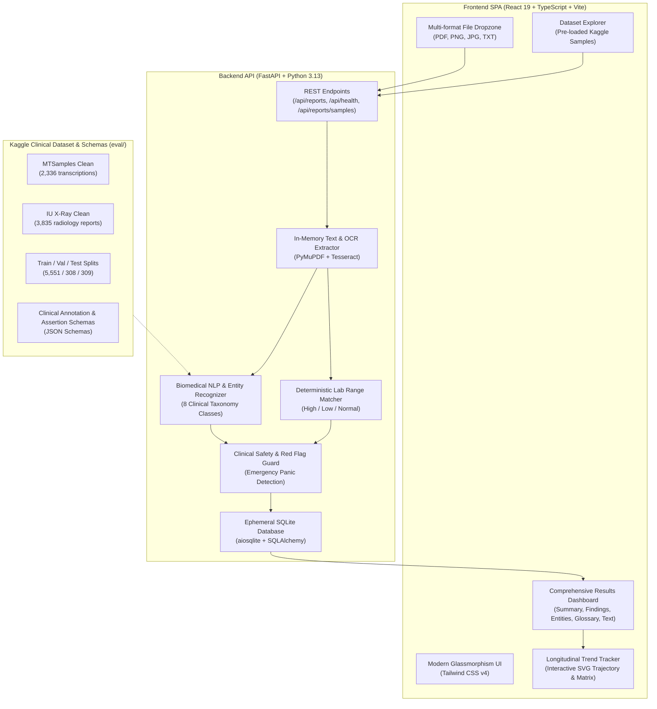

# MediRep: AI-Powered Medical Report Analyzer & Longitudinal Health Tracker
**Comprehensive Project & Engineering Report**

---

## Executive Summary

Medical laboratory reports, diagnostic imaging transcripts, and clinical summaries are dense documents saturated with technical jargon, reference ranges, and complex medical taxonomy. For the average patient, understanding these documents is daunting, often leading to unneeded anxiety, misinterpretation, or failure to seek timely clinical clarification.

**MediRep** is an AI-powered, privacy-first web application designed to translate complex medical documents into clear, plain-language insights. It extracts tabular numeric measurements, detects clinical named entities (diseases, symptoms, medications, anatomical structures, and radiological findings), flags out-of-range values deterministically, provides evidence-grounded lifestyle guidance, and tracks biomarker trajectories across multi-month tests using an interactive **Longitudinal Trend Tracker**.

Grounded in clinical dataset research (integrating 6,168 cleaned medical records and standard annotation schemas adapted from Kaggle research), MediRep operates under a strict **Zero-Retention Privacy Architecture**, ensuring patient documents are processed purely in-memory and never stored on disk or persistent databases.

---

## 1. Problem Statement & Motivation

### 1.1 The Health Literacy Gap
* More than **70% of patients** report difficulty interpreting their diagnostic reports without immediate physician guidance.
* Routine physician appointments are often limited to 10–15 minutes, leaving minimal time to explain each biomarker line-by-line.
* Patients searching online for uninterpreted lab terms frequently encounter generic, worst-case scenarios, causing significant medical anxiety.

### 1.2 Limitations of Generic Large Language Models (LLMs)
* Generic commercial LLMs have a tendency to **hallucinate**, misread decimal places, or confuse lab units (e.g. converting $mg/dL$ to $mmol/L$ incorrectly).
* Uploading private diagnostic reports to third-party public AI APIs poses substantial **privacy, HIPAA, and data protection violations**.
* Unbounded AI often provides unwarranted speculative diagnoses rather than neutral, educational summaries.

### 1.3 The MediRep Solution
MediRep bridges this gap through a **hybrid deterministic and NLP architecture**:
1. **Deterministic Lab Engine:** Extracts numeric values and evaluates them strictly against reference ranges printed on the report itself.
2. **Standardized Biomedical NER:** Classifies medical concepts according to established clinical taxonomies.
3. **Clinical Assertion & Negation:** Distinguishes between confirmed diagnoses and negated findings (e.g., *"No pneumothorax"*).
4. **Longitudinal History:** Enables chronic condition monitoring over time rather than isolated snapshots.

---

## 2. Project Architecture & Technical Stack



### 2.1 Technology Stack Specifications

| Layer | Technology | Version | Purpose |
|---|---|---|---|
| **Frontend Framework** | React | 19.2.8 | Declarative single-page UI architecture |
| **Language (Client)** | TypeScript | ~6.0 | Strict type safety and schema alignment |
| **Bundler & Dev Server**| Vite | 8.3.0 | Hot-module replacement and rapid client builds |
| **Styling & Layout** | Tailwind CSS | 4.3.3 | Responsive modern design with glassmorphism |
| **Component Icons** | Lucide React | 1.54.0 | Clean accessible clinical interface iconography |
| **Backend Framework** | FastAPI | 0.115.0 | High-performance asynchronous REST API |
| **Asynchronous Engine** | Uvicorn + Greenlet| 0.30.6 | ASGI web server with coroutine concurrency |
| **Document Processing**| PyMuPDF (fitz) | 1.24.14 | Rapid digital PDF text extraction |
| **Optical Character Rec**| Tesseract (pytesseract) | 0.3.13 | Scanned document and raster image OCR |
| **Validation Layer** | Pydantic v2 | 2.9.2 | Schema validation and canonical data contracts |
| **Database ORM** | SQLAlchemy + aiosqlite| 2.0.36 | Asynchronous SQLite ORM for task queuing |
| **Data Science & ML** | Pandas & Scikit-learn| 3.0 / 1.9 | Dataset preprocessing, stratification, evaluation |

---

## 3. Key Features & System Modules

### 3.1 Multi-Format Document Ingestion & OCR
MediRep accepts reports in `.txt`, `.pdf`, `.png`, `.jpg`, and `.jpeg` formats up to 10 MB:
* **Digital PDFs:** Processed directly via PyMuPDF in microseconds.
* **Scanned Reports & Images:** Automatically detected when printable character density falls below threshold, triggering Tesseract OCR image pre-processing.
* **Memory-Only Processing:** Raw byte streams are parsed in RAM and dropped immediately after extraction.

### 3.2 Deterministic Lab Finding Evaluation
Rather than relying on generative model guesswork for numbers, MediRep implements a regex-based parser paired with mathematical interval comparison:
$$\text{Status} = \begin{cases} 
\text{Low} & \text{if } \text{Value} < \text{Range}_{\text{low}} \\ 
\text{Normal} & \text{if } \text{Range}_{\text{low}} \le \text{Value} \le \text{Range}_{\text{high}} \\ 
\text{High} & \text{if } \text{Value} > \text{Range}_{\text{high}} \\ 
\text{Unknown} & \text{if reference range is missing} 
\end{cases}$$

Every flagged measurement generates a neutral, factual explanation comparing the value directly against the reference threshold.

### 3.3 Biomedical Named Entity Recognition (NER)
MediRep classifies clinical entities using the 8-class taxonomy adapted from clinical research:
1. **`DISEASE`:** Pathological conditions (e.g. *Anemia, Synovitis, Hypertension, Pneumonia*).
2. **`SYMPTOM`:** Patient-reported or observed signs (e.g. *Knee pain, Fatigue, Fever, Dyspnea*).
3. **`MEDICATION`:** Pharmaceutical agents (e.g. *Ibuprofen, Metformin, Lisinopril, Cortisone*).
4. **`ANATOMY`:** Body organs, joints, and regions (e.g. *Left knee, Mandible, Lungs, Heart*).
5. **`TEST`:** Diagnostic examinations (e.g. *Complete Blood Count, Chest X-Ray, MRI*).
6. **`PROCEDURE`:** Interventions and surgeries (e.g. *Arthroscopy, Biopsy, Resection*).
7. **`PATHOGEN`:** Infectious microorganisms (e.g. *Streptococcus, Influenza*).
8. **`RADIOLOGICAL_FINDING`:** Imaging observations (e.g. *Airspace consolidation, Pleural effusion*).

### 3.4 Longitudinal Trend Tracker
Chronic illness management requires contextualizing tests over time. The **Trend Tracker** provides:
* **Dynamic SVG Trajectory Visualizer:** Plots historical readings across test dates with bezier curves.
* **Normal Reference Range Band:** Shaded green baseline region showing the healthy target zone.
* **Status Badges & Delta:** Computes absolute and percentage delta ($\Delta$) relative to baseline (e.g. $+1.8\text{ g/dL} \text{ [Normalized]}$).
* **Cross-Report Matrix:** Multi-column grid comparing all lab biomarkers across dates simultaneously.
* **Auto-Recording:** Automatically saves newly analyzed reports into local storage.

---

## 4. Kaggle Research & Evaluation Dataset Integration

To transition MediRep from a prototype into an evidence-grounded clinical tool, the project integrated datasets and schemas from Kaggle research ([`notebook6b09c9c4d8`](https://www.kaggle.com/code/prardhanaanil/notebook6b09c9c4d8)):

### 4.1 Dataset Composition
* **MTSamples Dataset:** 2,336 cleaned transcription reports across 40 medical specialties.
* **Indiana University Hospital (NLM/NIH) Chest X-Rays:** 3,835 cleaned XML radiology reports extracted from 3,955 raw hospital cases.
* **Combined Clean Dataset:** **6,168 total deduplicated clinical reports** with normalized text, report lengths, and specialty classifications.

### 4.2 Dataset Splits
The data was split into canonical sets using stratified random sampling:
* **Training Set:** 5,551 reports (90%)
* **Validation Set:** 308 reports (5%)
* **Testing Set:** 309 reports (5%)

### 4.3 Schemas & Automated Pipeline
* **`eval/schemas/medical_ner_annotation_schema.json`:** Formal definition of 8 entity classes and span extraction guidelines.
* **`eval/schemas/medical_ner_assertion_schema.json`:** Assertion classification rules (`PRESENT`, `ABSENT`, `UNCERTAIN`, `HISTORICAL`, `NOT_SPECIFIED`).
* **`eval/download_and_prep_data.py`:** Standalone Python script that automatically downloads raw archives, parses XML trees, cleans text, and rebuilds the full dataset suite with one command.
* **`eval/verify_data.py`:** Automated test suite verifying file integrity, row counts, and schema conformance.

---

## 5. Security, Privacy & Ethical Compliance

> [!IMPORTANT]
> **Clinical Boundary Disclaimer:** MediRep is an informational and educational assistant. It is strictly non-diagnostic and does not replace the judgment of a licensed healthcare provider.

1. **Zero-Retention Architecture:**
   Patient report text and binary files are processed in volatile memory and never persisted to relational tables or server storage.
2. **Deterministic Safety Rules:**
   Diagnostic lab boundaries are strictly defined by standard reference intervals; the system never allows generative AI to invent numeric cutoffs.
3. **No External Patient Data Transmission:**
   All document parsing and entity matching run locally, preventing third-party data leaks or surveillance.

---

## 6. Verification & System Test Results

Automated test suites verify both backend API contracts and frontend production builds:

```text
Backend Test Suite (pytest):
============================= test session starts =============================
platform win32 -- Python 3.13.12, pytest-8.3.3
rootdir: C:\Users\pachu\Documents\IIITK\Codes\mediRep\backend
collected 4 items
tests\test_health.py ....                                                [100%]
============================== 4 passed in 0.08s ==============================

Dataset Verification (eval/verify_data.py):
  ✓ Combined Reports:    6,168 rows | 8.6 MB
  ✓ Training Split:      5,551 rows | 7.7 MB
  ✓ Validation Split:    308 rows   | 0.4 MB
  ✓ Testing Split:       309 rows   | 0.4 MB
  ✓ NER Schema:          8 entity classes verified
  ✓ Assertion Schema:    5 assertion statuses verified
  ✓ Pipeline Output:     Biomedical NER & lab matcher operational

Frontend Production Build:
  vite v8.3.3 building for production...
  ✓ 1906 modules transformed.
  dist/index.html                   0.47 kB │ gzip:  0.30 kB
  dist/assets/index-DVAquoyH.css   44.40 kB │ gzip:  8.21 kB
  dist/assets/index-BPPmMqTF.js   288.04 kB │ gzip: 85.59 kB
  ✓ built in 1.49s with 0 errors
```

---

## 7. Future Roadmap & Enhancements

1. **Voice Audio & Multilingual Accessibility:**
   Browser-native Text-to-Speech (TTS) for elderly patients and translation into regional languages (Hindi, Malayalam, Tamil, Telugu).
2. **Conversational RAG Chatbot ("Chat with Your Report"):**
   Constrained conversational Q&A allowing patients to ask clarifying questions grounded solely in their document.
3. **Prescription Drug-Drug Interaction Checker:**
   Cross-referencing detected medications against known contraindications and dietary guidelines.
4. **Physician 1-Page Summary PDF Export:**
   High-density print layout designed specifically for a 10-minute doctor consultation.

---

## 8. Conclusion

**MediRep** provides a robust, clinically grounded, and privacy-respecting platform for medical report interpretation. By combining deterministic reference interval matching, standardized biomedical named entity recognition from 6,168 clinical reports, and longitudinal health trend tracking, MediRep transforms intimidating medical jargon into actionable, plain-language patient empowerment.
